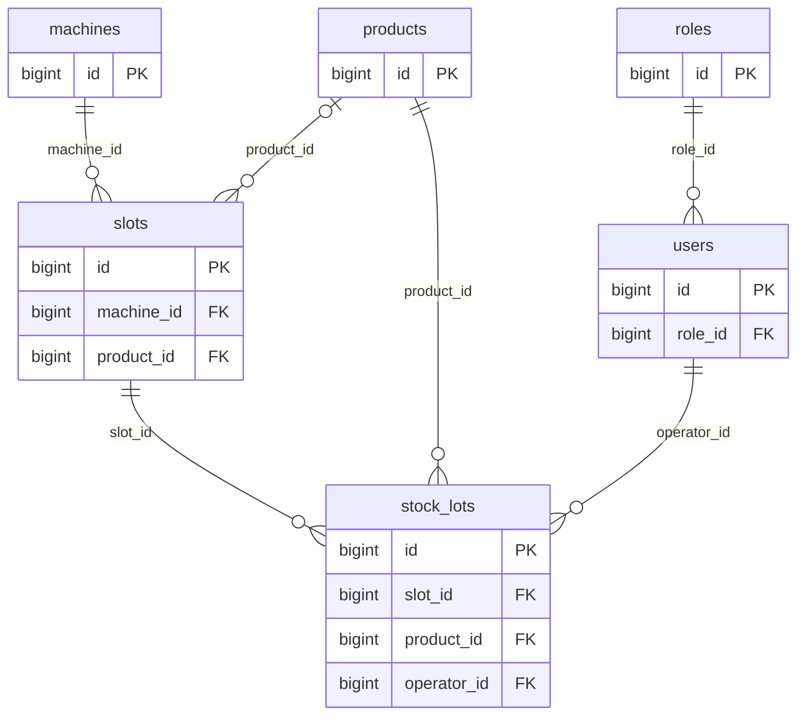
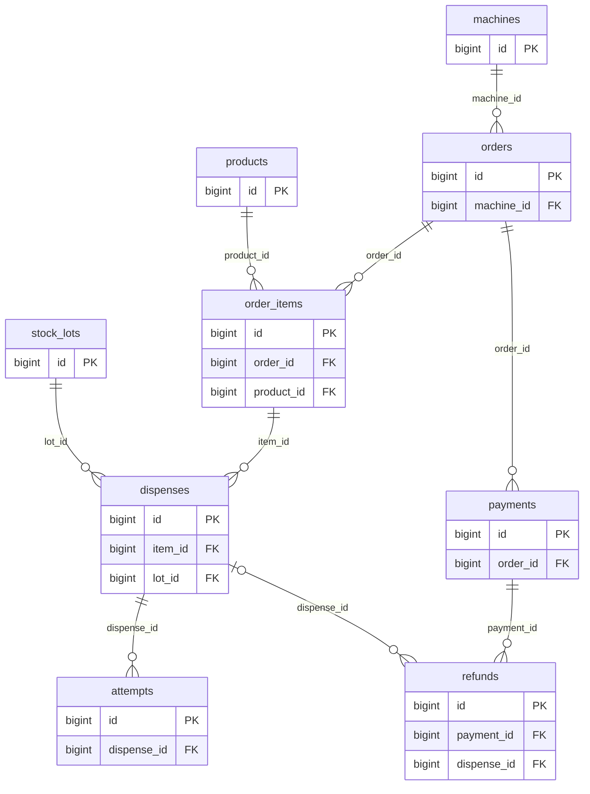
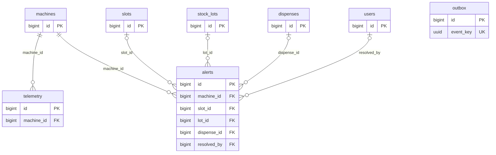

# FreshVend – Thiết kế cơ sở dữ liệu PostgreSQL

## 1. Danh sách các bảng
| STT | Tên bảng | Dữ liệu lưu trữ |
|---|---|---|
| 1 | `roles` | Các vai trò như quản trị viên, nhân viên vận hành và nhân viên bảo trì. |
| 2 | `users` | Tài khoản của nhân viên và vai trò được gán cho từng tài khoản. |
| 3 | `machines` | Máy bán hàng, địa điểm đặt máy, trạng thái và ngưỡng nhiệt độ. |
| 4 | `products` | Các loại tô trái cây, tên sản phẩm, hình ảnh và giá bán. |
| 5 | `slots` | Các ngăn trong từng máy, sức chứa và sản phẩm được gán cho mỗi ngăn. |
| 6 | `stock_lots` | Từng lô hàng nhập vào ngăn, người nhập, thời điểm nhập, hạn sử dụng và số lượng còn lại. |
| 7 | `orders` | Thông tin chung của một đơn hàng, gồm máy bán, thời điểm mua, trạng thái và mã biên nhận. |
| 8 | `order_items` | Từng loại sản phẩm trong đơn, số lượng mua và đơn giá tại thời điểm mua. |
| 9 | `payments` | Từng lần thanh toán cho đơn hàng, gồm phương thức, số tiền và kết quả. |
| 10 | `dispenses` | Lệnh xuất từng tô trái cây và trạng thái giao tô đó cho khách. |
| 11 | `attempts` | Từng lần máy thực hiện lệnh xuất tô và kết quả, kể cả lần thử lại khi bị kẹt. |
| 12 | `refunds` | Khoản tiền hoàn cho khách và trạng thái xử lý. |
| 13 | `telemetry` | Dữ liệu máy gửi về theo thời gian, gồm nhiệt độ, độ ẩm và trạng thái cửa. |
| 14 | `alerts` | Cảnh báo tồn kho thấp, sắp hết hạn, nhiệt độ bất thường hoặc kẹt hàng và kết quả xử lý. |
| 15 | `outbox` | Các lệnh hoặc thông báo đang chờ gửi, cùng thông tin để gửi lại khi gặp lỗi. |

## 2. Mô tả các cột của từng bảng

### 2.1. Bảng `roles` – Vai trò người dùng

| Tên cột | Ý nghĩa | Kiểu dữ liệu PostgreSQL | Cho phép NULL? |
|---|---|---|---|
| `id` | Khóa chính dùng để xác định từng vai trò. PostgreSQL tự sinh giá trị. | `BIGINT GENERATED BY DEFAULT AS IDENTITY` | Không |
| `code` | Mã vai trò, ví dụ `ADMIN`, `OPERATOR` hoặc `MAINTENANCE`. Mỗi mã là duy nhất. | `TEXT` | Không |

### 2.2. Bảng `users` – Tài khoản nhân viên

| Tên cột | Ý nghĩa | Kiểu dữ liệu PostgreSQL | Cho phép NULL? |
|---|---|---|---|
| `id` | Khóa chính của tài khoản. PostgreSQL tự sinh giá trị. | `BIGINT GENERATED BY DEFAULT AS IDENTITY` | Không |
| `login` | Tên đăng nhập. Mỗi tài khoản có một tên đăng nhập duy nhất. | `TEXT` | Không |
| `password_hash` | Giá trị băm của mật khẩu, dùng để xác thực khi đăng nhập. | `TEXT` | Không |
| `role_id` | Khóa ngoại tham chiếu đến `roles.id`, xác định vai trò của tài khoản. | `BIGINT` | Không |
| `active` | Trạng thái tài khoản. `TRUE` là đang hoạt động, `FALSE` là đã bị vô hiệu hóa. | `BOOLEAN` | Không |

### 2.3. Bảng `machines` – Máy bán hàng

| Tên cột | Ý nghĩa | Kiểu dữ liệu PostgreSQL | Cho phép NULL? |
|---|---|---|---|
| `id` | Khóa chính của máy. PostgreSQL tự sinh giá trị. | `BIGINT GENERATED BY DEFAULT AS IDENTITY` | Không |
| `code` | Mã máy duy nhất, ví dụ `FV-001`. | `TEXT` | Không |
| `location` | Địa điểm đặt máy. | `TEXT` | Không |
| `status` | Trạng thái hoạt động hiện tại của máy. | `TEXT` | Không |
| `min_c` | Ngưỡng nhiệt độ thấp dùng để cảnh báo, tính bằng °C. | `NUMERIC` | Không |
| `max_c` | Ngưỡng nhiệt độ cao dùng để cảnh báo, tính bằng °C. | `NUMERIC` | Không |
| `degraded_message` | Nội dung hiển thị cho khách khi khả năng làm lạnh của máy suy giảm. | `TEXT` | Không |
| `last_seen_at` | Thời điểm gần nhất hệ thống nhận tín hiệu từ máy. Để trống khi máy mới được đăng ký và chưa gửi tín hiệu. | `TIMESTAMPTZ` | Có |

### 2.4. Bảng `products` – Sản phẩm

| Tên cột | Ý nghĩa | Kiểu dữ liệu PostgreSQL | Cho phép NULL? |
|---|---|---|---|
| `id` | Khóa chính của sản phẩm. PostgreSQL tự sinh giá trị. | `BIGINT GENERATED BY DEFAULT AS IDENTITY` | Không |
| `sku` | Mã sản phẩm duy nhất, ví dụ `BOWL-XOAI`. | `TEXT` | Không |
| `name` | Tên tô trái cây hiển thị cho khách hàng. | `TEXT` | Không |
| `image_url` | Đường dẫn đến hình ảnh sản phẩm. | `TEXT` | Không |
| `price_vnd` | Giá bán hiện tại của một tô, tính bằng đồng Việt Nam. | `BIGINT` | Không |
| `active` | Cho biết sản phẩm còn được kinh doanh hay đã ngừng kinh doanh. | `BOOLEAN` | Không |

### 2.5. Bảng `slots` – Ngăn chứa sản phẩm

| Tên cột | Ý nghĩa | Kiểu dữ liệu PostgreSQL | Cho phép NULL? |
|---|---|---|---|
| `id` | Khóa chính của ngăn. PostgreSQL tự sinh giá trị. | `BIGINT GENERATED BY DEFAULT AS IDENTITY` | Không |
| `machine_id` | Khóa ngoại tham chiếu `machines.id`, xác định ngăn thuộc máy nào. | `BIGINT` | Không |
| `slot_no` | Số thứ tự ngăn trong máy. Mỗi máy chỉ có một ngăn mang cùng số thứ tự. | `INTEGER` | Không |
| `product_id` | Khóa ngoại tham chiếu `products.id`. Để trống khi ngăn chưa được gán sản phẩm. | `BIGINT` | Có |
| `capacity` | Số tô tối đa ngăn có thể chứa. | `INTEGER` | Không |
| `low_threshold` | Ngưỡng cảnh báo tồn kho thấp của ngăn, tính theo số tô. | `INTEGER` | Không |

### 2.6. Bảng `stock_lots` – Lô hàng nhập vào ngăn

| Tên cột | Ý nghĩa | Kiểu dữ liệu PostgreSQL | Cho phép NULL? |
|---|---|---|---|
| `id` | Khóa chính của lô hàng. PostgreSQL tự sinh giá trị. | `BIGINT GENERATED BY DEFAULT AS IDENTITY` | Không |
| `slot_id` | Khóa ngoại tham chiếu `slots.id`, xác định ngăn nhận lô hàng. | `BIGINT` | Không |
| `product_id` | Khóa ngoại tham chiếu `products.id`, xác định sản phẩm của lô tại thời điểm nhập. | `BIGINT` | Không |
| `operator_id` | Khóa ngoại tham chiếu `users.id`, xác định nhân viên nhập hàng. | `BIGINT` | Không |
| `received_at` | Thời điểm nhập lô vào ngăn. Dùng để xác định lô nhập trước khi xuất hàng theo FIFO. | `TIMESTAMPTZ` | Không |
| `expires_at` | Thời điểm lô hàng hết hạn sử dụng. | `TIMESTAMPTZ` | Không |
| `qty_in` | Số tô được nhập ban đầu. | `INTEGER` | Không |
| `qty_on_hand` | Số tô hiện còn trong ngăn thuộc lô này. | `INTEGER` | Không |

### 2.7. Bảng `orders` – Đơn hàng

| Tên cột | Ý nghĩa | Kiểu dữ liệu PostgreSQL | Cho phép NULL? |
|---|---|---|---|
| `id` | Khóa chính của đơn hàng. PostgreSQL tự sinh giá trị. | `BIGINT GENERATED BY DEFAULT AS IDENTITY` | Không |
| `machine_id` | Khóa ngoại tham chiếu `machines.id`, xác định máy nơi khách đặt mua. | `BIGINT` | Không |
| `location_at_sale` | Địa điểm của máy tại thời điểm bán, dùng để thống kê doanh thu ngay cả khi máy được chuyển đi sau đó. | `TEXT` | Không |
| `receipt_no` | Mã biên nhận duy nhất để tra cứu giao dịch. | `TEXT` | Không |
| `created_at` | Thời điểm tạo đơn hàng. | `TIMESTAMPTZ` | Không |
| `status` | Trạng thái xử lý của đơn hàng. | `TEXT` | Không |
| `reservation_until` | Thời điểm hết hạn giữ hàng cho đơn trong lúc chờ thanh toán. | `TIMESTAMPTZ` | Không |

### 2.8. Bảng `order_items` – Chi tiết đơn hàng

| Tên cột | Ý nghĩa | Kiểu dữ liệu PostgreSQL | Cho phép NULL? |
|---|---|---|---|
| `id` | Khóa chính của dòng chi tiết đơn hàng. PostgreSQL tự sinh giá trị. | `BIGINT GENERATED BY DEFAULT AS IDENTITY` | Không |
| `order_id` | Khóa ngoại tham chiếu `orders.id`, xác định dòng này thuộc đơn nào. | `BIGINT` | Không |
| `product_id` | Khóa ngoại tham chiếu `products.id`, xác định loại tô khách mua. | `BIGINT` | Không |
| `qty` | Số tô khách mua của loại sản phẩm này. | `INTEGER` | Không |
| `unit_price_vnd` | Đơn giá một tô tại thời điểm mua, tính bằng đồng Việt Nam. Giá này được giữ lại khi giá bán trong danh mục thay đổi. | `BIGINT` | Không |

### 2.9. Bảng `payments` – Các lần thanh toán

| Tên cột | Ý nghĩa | Kiểu dữ liệu PostgreSQL | Cho phép NULL? |
|---|---|---|---|
| `id` | Khóa chính của lần thanh toán. PostgreSQL tự sinh giá trị. | `BIGINT GENERATED BY DEFAULT AS IDENTITY` | Không |
| `order_id` | Khóa ngoại tham chiếu `orders.id`, xác định đơn cần thanh toán. | `BIGINT` | Không |
| `request_key` | Mã duy nhất của yêu cầu thanh toán, dùng để nhận biết yêu cầu được gửi lại. | `UUID` | Không |
| `provider_ref` | Mã giao dịch do cổng thanh toán cung cấp. Để trống khi chưa nhận được mã. | `TEXT` | Có |
| `method` | Phương thức thanh toán, ví dụ QR, ví điện tử hoặc thẻ. | `TEXT` | Không |
| `amount_vnd` | Số tiền của lần thanh toán, tính bằng đồng Việt Nam. | `BIGINT` | Không |
| `status` | Trạng thái của lần thanh toán, chẳng hạn đang chờ, thành công hoặc thất bại. | `TEXT` | Không |
| `created_at` | Thời điểm tạo yêu cầu thanh toán. | `TIMESTAMPTZ` | Không |
| `paid_at` | Thời điểm xác nhận thu tiền thành công. Để trống khi chưa thu được tiền. | `TIMESTAMPTZ` | Có |

### 2.10. Bảng `dispenses` – Lệnh xuất từng tô

| Tên cột | Ý nghĩa | Kiểu dữ liệu PostgreSQL | Cho phép NULL? |
|---|---|---|---|
| `id` | Khóa chính của lệnh xuất một tô. PostgreSQL tự sinh giá trị. | `BIGINT GENERATED BY DEFAULT AS IDENTITY` | Không |
| `item_id` | Khóa ngoại tham chiếu `order_items.id`, xác định tô thuộc dòng nào của đơn hàng. | `BIGINT` | Không |
| `lot_id` | Khóa ngoại tham chiếu `stock_lots.id`, xác định lô hàng dùng để xuất tô. | `BIGINT` | Không |
| `unit_no` | Số thứ tự của tô trong dòng đơn hàng. Nếu khách mua hai tô cùng loại thì hai tô có số thứ tự 1 và 2. | `INTEGER` | Không |
| `command_key` | Mã duy nhất của lệnh để thiết bị nhận biết khi cùng một lệnh được gửi lại. | `UUID` | Không |
| `status` | Trạng thái của lệnh, chẳng hạn đã giữ tô, đang xuất, đã giao hoặc thất bại. | `TEXT` | Không |
| `delivered_at` | Thời điểm thiết bị xác nhận đã giao tô. Để trống khi chưa xác nhận giao thành công. | `TIMESTAMPTZ` | Có |

### 2.11. Bảng `attempts` – Các lần máy thử xuất tô

| Tên cột | Ý nghĩa | Kiểu dữ liệu PostgreSQL | Cho phép NULL? |
|---|---|---|---|
| `id` | Khóa chính của lần thử xuất tô. PostgreSQL tự sinh giá trị. | `BIGINT GENERATED BY DEFAULT AS IDENTITY` | Không |
| `dispense_id` | Khóa ngoại tham chiếu `dispenses.id`, xác định lệnh xuất đang được thực hiện. | `BIGINT` | Không |
| `attempt_no` | Số thứ tự lần thử trong cùng một lệnh. Lần đầu là 1, lần thử lại tiếp theo là 2. | `INTEGER` | Không |
| `result` | Kết quả lần thử, chẳng hạn xuất thành công hoặc kẹt hàng. | `TEXT` | Không |
| `event_key` | Mã duy nhất của sự kiện để tránh ghi trùng khi thiết bị gửi lại kết quả. | `UUID` | Không |
| `recorded_at` | Thời điểm ghi nhận kết quả lần thử. | `TIMESTAMPTZ` | Không |

### 2.12. Bảng `refunds` – Hoàn tiền

| Tên cột | Ý nghĩa | Kiểu dữ liệu PostgreSQL | Cho phép NULL? |
|---|---|---|---|
| `id` | Khóa chính của khoản hoàn tiền. PostgreSQL tự sinh giá trị. | `BIGINT GENERATED BY DEFAULT AS IDENTITY` | Không |
| `payment_id` | Khóa ngoại tham chiếu `payments.id`, xác định khoản thanh toán cần hoàn. | `BIGINT` | Không |
| `dispense_id` | Khóa ngoại tham chiếu `dispenses.id` khi hoàn tiền cho một tô. Để trống khi hoàn toàn bộ giao dịch do xác nhận thanh toán đến sau hạn giữ hàng. | `BIGINT` | Có |
| `request_key` | Mã duy nhất của yêu cầu hoàn tiền để nhận biết yêu cầu gửi lại. | `UUID` | Không |
| `amount_vnd` | Số tiền cần hoàn cho khách, tính bằng đồng Việt Nam. | `BIGINT` | Không |
| `status` | Trạng thái xử lý khoản hoàn tiền. | `TEXT` | Không |
| `completed_at` | Thời điểm cổng thanh toán xác nhận hoàn tiền thành công. Để trống khi chưa hoàn thành. | `TIMESTAMPTZ` | Có |

### 2.13. Bảng `telemetry` – Nhật ký dữ liệu thiết bị

| Tên cột | Ý nghĩa | Kiểu dữ liệu PostgreSQL | Cho phép NULL? |
|---|---|---|---|
| `id` | Khóa chính của bản ghi thiết bị. PostgreSQL tự sinh giá trị. | `BIGINT GENERATED BY DEFAULT AS IDENTITY` | Không |
| `machine_id` | Khóa ngoại tham chiếu `machines.id`, xác định máy gửi dữ liệu. | `BIGINT` | Không |
| `event_key` | Mã duy nhất của bản tin để nhận biết dữ liệu thiết bị gửi lại. | `UUID` | Không |
| `measured_at` | Thời điểm thiết bị đo hoặc ghi nhận trạng thái. | `TIMESTAMPTZ` | Không |
| `received_at` | Thời điểm backend nhận được bản tin. | `TIMESTAMPTZ` | Không |
| `temp_c` | Nhiệt độ đo được, tính bằng °C. Để trống nếu bản tin thiếu số đo nhiệt độ. | `NUMERIC` | Có |
| `humidity_pct` | Độ ẩm đo được, tính theo phần trăm. Để trống nếu bản tin thiếu số đo độ ẩm. | `NUMERIC` | Có |
| `door_open` | Trạng thái cửa máy. `TRUE` là mở, `FALSE` là đóng. Để trống nếu chưa xác định được trạng thái cửa. | `BOOLEAN` | Có |
| `device_state` | Trạng thái hoạt động của thiết bị tại thời điểm ghi nhận. | `TEXT` | Không |

### 2.14. Bảng `alerts` – Cảnh báo và xử lý sự cố

| Tên cột | Ý nghĩa | Kiểu dữ liệu PostgreSQL | Cho phép NULL? |
|---|---|---|---|
| `id` | Khóa chính của cảnh báo. PostgreSQL tự sinh giá trị. | `BIGINT GENERATED BY DEFAULT AS IDENTITY` | Không |
| `machine_id` | Khóa ngoại tham chiếu `machines.id`, xác định máy phát sinh cảnh báo. | `BIGINT` | Không |
| `slot_id` | Khóa ngoại tham chiếu `slots.id`. Điền khi cảnh báo liên quan đến một ngăn cụ thể. | `BIGINT` | Có |
| `lot_id` | Khóa ngoại tham chiếu `stock_lots.id`. Điền khi cảnh báo liên quan đến một lô hàng, ví dụ lô sắp hết hạn. | `BIGINT` | Có |
| `dispense_id` | Khóa ngoại tham chiếu `dispenses.id`. Điền khi cảnh báo liên quan đến một lệnh xuất, ví dụ kẹt hàng. | `BIGINT` | Có |
| `kind` | Loại cảnh báo, ví dụ tồn thấp, sắp hết hạn, nhiệt độ bất thường hoặc kẹt hàng. | `TEXT` | Không |
| `severity` | Mức độ nghiêm trọng của cảnh báo. | `TEXT` | Không |
| `opened_at` | Thời điểm phát sinh cảnh báo. | `TIMESTAMPTZ` | Không |
| `resolved_at` | Thời điểm xử lý xong. Để trống khi cảnh báo còn mở. | `TIMESTAMPTZ` | Có |
| `resolved_by` | Khóa ngoại tham chiếu `users.id`. Điền khi có nhân viên xác nhận đã xử lý. | `BIGINT` | Có |
| `resolution` | Ghi chú về cách xử lý sự cố. Để trống khi chưa có ghi chú. | `TEXT` | Có |

### 2.15. Bảng `outbox` – Hàng đợi gửi lệnh và thông báo

| Tên cột | Ý nghĩa | Kiểu dữ liệu PostgreSQL | Cho phép NULL? |
|---|---|---|---|
| `id` | Khóa chính của thông điệp. PostgreSQL tự sinh giá trị. | `BIGINT GENERATED BY DEFAULT AS IDENTITY` | Không |
| `event_key` | Mã duy nhất của sự kiện, giữ nguyên nếu phải gửi lại. | `UUID` | Không |
| `event_type` | Loại sự kiện, ví dụ lệnh xuất hàng hoặc thông báo cảnh báo. | `TEXT` | Không |
| `payload` | Nội dung cần gửi dưới dạng JSON, ví dụ mã máy và mã lệnh xuất. | `JSONB` | Không |
| `status` | Trạng thái gửi, chẳng hạn đang chờ, đã gửi hoặc đã dừng sau nhiều lần lỗi. | `TEXT` | Không |
| `attempt_count` | Số lần hệ thống đã thử gửi thông điệp. | `INTEGER` | Không |
| `next_try_at` | Thời điểm sớm nhất hệ thống được thử gửi khi thông điệp còn chờ xử lý. | `TIMESTAMPTZ` | Không |
| `last_error` | Nội dung lỗi của lần gửi gần nhất. Để trống nếu chưa xảy ra lỗi. | `TEXT` | Có |

## 4. Sơ đồ quan hệ thực thể (ERD)

Ba hình dưới đây thể hiện các phần của cùng một cơ sở dữ liệu FreshVend.
PK là khóa chính, FK là khóa ngoại. Mỗi đường nối mang tên cột FK tương ứng.

### 4.1. Tài khoản, máy bán hàng và nhập kho

### 4.2. Đơn hàng, thanh toán, xuất hàng và hoàn tiền

### 4.3. Dữ liệu thiết bị, cảnh báo và hàng đợi

Bảng `outbox` đứng riêng vì thiết kế không khai báo FK cho bảng này.
Các bảng xuất hiện lại giữa các hình, như `machines`, là cùng một bảng.